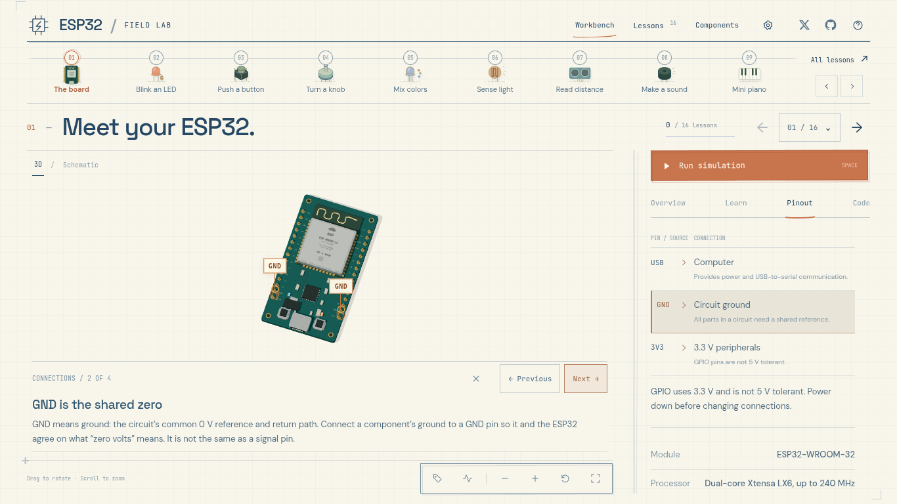
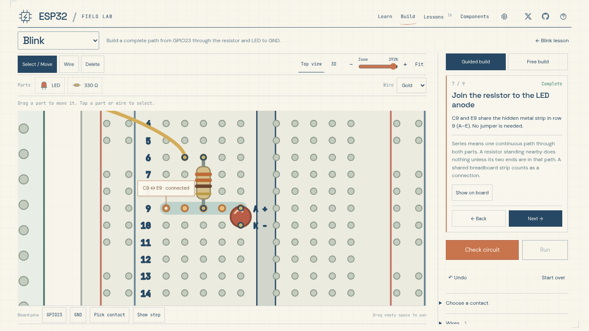

# ESP32 Field Lab

An interactive, browser-based classroom for the original 30-pin ESP32 DevKit V1 with ESP32-WROOM-32. Explore a 3D board, operate components, and follow 16 English lessons from your desktop or phone.

**[Open the lab](https://ardchain.github.io/esp32-field-lab/)**



- Procedural 3D board and component models, with hover and tap inspection.
- Direct interaction: hold a button, turn a knob, cover a light sensor, play piano keys or move a servo.
- 68 visual connection steps: the camera frames each part and highlights exact pins and resistor values. Every Pinout row opens its matching explanation.
- Electrical diagrams, a breadboard primer, Arduino examples, experiments and knowledge checks.
- Assembly practice for Blink, Button and Potentiometer: place components, connect real breadboard strips, check the circuit and operate it in 3D.
- Saved lesson progress and assembly drafts in your current browser; no account or backend required.
- A desktop workbench that fits the window, with scrolling inside the lesson panel; touch controls and page scrolling on phones.
- Keyboard navigation and reduced-motion support.

## Lessons

Board basics · LED blink · Button · Potentiometer · RGB LED · Light sensor · Ultrasonic distance · Piezo sound · Mini piano · DC motor · Temperature · Servo · Stepper motor · Plant monitor · Force sensor · Wi-Fi

## Run locally

The site is plain HTML, CSS and JavaScript. Three.js and fonts are bundled locally; there is no build step.

```sh
git clone https://github.com/ardchain/esp32-field-lab.git
cd esp32-field-lab
python3 -m http.server 4173 -d dist
```

Open <http://localhost:4173>. Serve the files over HTTP rather than opening `index.html` directly, because the application uses JavaScript modules.

## Lesson controls

Drag empty space to rotate horizontally. Scroll or pinch to zoom. Hover or tap a passive part to inspect it, or use the component library. Operate interactive parts using the hint above the scene; the demonstration starts automatically. Shift/Alt-click an interactive part to inspect it.

Choose **Show the connections**, or select a **Pinout** row, for a guided close-up. Running the simulation or taking manual control of the camera returns to free exploration. Labels are off by default.

- **Space:** run or stop the demonstration.
- **R:** reset the camera.
- **[ / ]:** previous or next lesson.
- **Escape:** close a panel.

## Build a circuit

Open **Build** in the navigation and choose a project. **Guided build** starts by showing the hidden connections inside the breadboard: five-hole strips, the center gap and the power rails. Each following step highlights a part or connection and explains its purpose. Click a suggested component's ghost to place its entire footprint, or use **Do this step**. **Next** moves to the following explanation. The guide follows your actual layout, including valid alternative arrangements; it preserves saved circuits.

Use **Free build** to explore directly. Place components from the tray, then choose **Wire** and select two contacts. Drag a placed component to move it. Select a wire and drag either endpoint to reconnect it; its other end stays in place. An invalid drop preserves the original wire. Click a part or wire to select it; click the selected body again to remove it, then use **Undo** to restore it. The Delete tool and keyboard Delete/Backspace remain available. Scroll, pinch or use the **Zoom** slider to change the view. Contact selectors provide an alternative to pointing at small holes.

| Project | Circuit and behavior |
| --- | --- |
| [Blink](https://ardchain.github.io/esp32-field-lab/#build-blink) | GPIO23 drives an LED through a resistor; change its blink interval. |
| [Button](https://ardchain.github.io/esp32-field-lab/#build-button) | Wire a four-leg switch to GPIO18 and GND; pressing it reads LOW and lights the LED. |
| [Potentiometer](https://ardchain.github.io/esp32-field-lab/#build-potentiometer) | Power a 10 kΩ potentiometer from 3.3 V; its wiper feeds GPIO34 and controls LED brightness. |



**Check** evaluates connectivity, LED polarity, current limiting, occupied holes and power shorts. Valid layouts may use different rows, wire colors, power rails or a resistor on either side of the LED. Each breadboard row connects a–e separately from f–j; the four power rails are continuous and independent. Each contact holds one lead or jumper. The two ESP32 ground pins share a net but are separate physical contacts.

In Wire mode, an occupied terminal resolves to a free contact on the same conducting connection; the preview shows the actual endpoint before you connect it. This follows breadboard strips and existing wires, never a resistor or LED. Already connected endpoints do not add duplicate wires. Guided wiring advances to the next connection after each completed wire.

Run is available after a successful check. Editing or restoring a draft stops playback and requires a fresh check. Hints show proposed components or wires at their actual positions, with short explanations beside the target. If a wire feeds the LED directly and bypasses the resistor, a repair guide identifies the wire end to move and the remaining connection. Each repair requires an explicit action and can be undone. Undo preserves the previous edit, including a reset. Each project has its own saved draft; assembly completion is separate from lesson quizzes.

These are connectivity checkers for the three supplied projects, not an arbitrary electrical solver or C++ compiler. Each checked circuit drives its matching demonstration. The button models its two permanently connected leg pairs and its pressed state. The potentiometer models distinct track ends and a wiper, including reversed outer connections. Lesson scenes retain their illustrative wires; Build mode attaches its wires to the selected contacts.

## Project structure

| Path | Purpose |
| --- | --- |
| `dist/index.html` | Application shell |
| `dist/app.js` | Navigation, lesson panels, controls, quizzes and progress |
| `dist/scene.js` | Procedural 3D models, camera, highlights, assembly rendering and interactions |
| `dist/build.js`, `dist/build.css` | Assembly editor, hints, validation feedback and draft persistence |
| `dist/build-circuit.js` | Breadboard nets, component footprints, occupancy and project circuit rules |
| `dist/build-projects.js` | Assembly project catalog, example placements, controls and sketches |
| `dist/build-walkthroughs.js` | Guided assembly explanations and connection steps that follow the learner's actual layout |
| `dist/lessons.js` | Lesson content, Arduino sketches and component reference |
| `dist/guides.js` | Step-by-step visual connection tours |
| `dist/diagrams.js` | Circuit diagrams and breadboard connectivity |
| `dist/style.css`, `dist/guide.css` | Responsive layout and styles |
| `tests/` | Circuit-rule tests and browser regression checks |

## Checks

Node.js 20 or later is needed for the development checks. Python 3 is only needed for the local server above.

```sh
npm ci
npm run check
npx playwright install --with-deps chromium
npm test
```

The checks cover all lessons, direct device interactions, visual-guide targets, navigation, camera bounds, quizzes, stored progress and narrow layouts. Assembly checks include breadboard connectivity, alternate valid circuits, common wiring faults, real pointer/keyboard/touch assembly, wheel zoom, dragging, deletion, visual hints, 3D playback, undo, saved drafts and downloaded code.

Run `npm run test:circuit` for the circuit rules alone, or `npm run test:build` for circuit rules plus assembly browser checks. Browser tests inject observation helpers into the served test response; production has no test globals. They start local servers on ports 4181, 4184, 4185 and 4194. Screenshots and reports go into temporary directories, or a directory set with `QA_OUTPUT`.

To use an already-installed Chromium, set `CHROMIUM_EXECUTABLE` to its executable path before running the tests.

## Deploy

The included GitHub Actions workflow publishes `dist/` to GitHub Pages whenever `main` changes. In the repository's **Settings → Pages**, choose **GitHub Actions** as the source. Assets use relative paths, so the site also works at a project URL such as `/esp32-field-lab/`.

You can serve `dist/` with any static host, including Vercel, Netlify or a conventional web server.

## Simulation and hardware

The browser runs interactive lesson demonstrations. It does not compile C++, emulate an ESP32 CPU, or connect to a physical board. The output monitor reports the demonstration state. Six output controls update constants in the downloadable examples; sensor controls change simulated conditions.

Arduino examples target Arduino-ESP32 3.x and the original ESP32-WROOM-32. Library-dependent sketches and physical wiring should be verified on the intended board; other ESP32 variants have different pins and features. GPIO uses 3.3 V and is not 5 V tolerant. The 3D scenes illustrate the setup; the wiring tables and electrical diagrams describe the intended connections.

Progress and preferences use localStorage. They stay in the same browser and site origin and do not sync between devices or domains.

### 3D model references

The models depict selected component packages and common board variants. Terminal counts, pin names and mechanical orientation follow the references below; dimensions and small details are adapted for readability. These are stylized teaching illustrations, not dimensioned CAD or assembly drawings. Piano keycaps represent the eight input switches. Lesson breadboard wire endpoints are illustrative; Build mode uses the selected contact coordinates.

| Model | Hardware reference |
| --- | --- |
| 30-pin ESP32 DevKit V1 | [DOIT documentation](https://github.com/SmartArduino/SZDOITWiKi/wiki/ESP8266---ESP32) and [manufacturer schematics](https://github.com/SmartArduino/ESPboard/blob/master/esp32manual.rar) |
| ESP-WROOM-32 module | [Espressif datasheet](https://documentation.espressif.com/esp32-wroom-32_datasheet_en.html): 38 castellated terminals and PCB antenna |
| USB bridge and regulator | [CP2102 QFN28](https://www.silabs.com/documents/public/data-sheets/CP2102-9.pdf), [1117 SOT-223 package](https://www.onsemi.com/pdf/datasheet/ncp1117-d.pdf) |
| Common-cathode RGB LED | [Kingbright four-lead LED](https://www.kingbrightusa.com/images/catalog/SPEC/WP154A4SUREQBFZGC.pdf) |
| Ultrasonic module | [Classic 5 V HC-SR04](https://cdn.sparkfun.com/datasheets/Sensors/Proximity/HCSR04.pdf) |
| Temperature and humidity sensor | [Aosong DHT22 / AM2302 datasheet](https://www.airsupplylab.com/images/Learn/Embedded/Datasheets/DHT22_Temperature_and_Humidity_Sensor.pdf): bare four-pin package |
| Servo | [TowerPro SG90](https://towerpro.com.tw/product/sg90-analog/) |
| Stepper and driver | [28BYJ-48](https://download.mikroe.com/documents/datasheets/step-motor-5v-28byj48-datasheet.pdf), [ULN2003A DIP-16](https://www.ti.com/lit/ds/symlink/uln2003a.pdf) |
| DC motor switching circuit | [AO3400A SOT-23](https://www.aosmd.com/res/data_sheets/AO3400A.pdf) on a generic breakout; [axial diode and cathode band](https://www.vishay.com/docs/88503/1n4001.pdf) |
| Analog inputs | [Three-terminal potentiometer](https://www.bourns.com/docs/product-datasheets/PTV09.pdf), [two-terminal FSR](https://www.interlinkelectronics.com/downloads/datasheets/fsr-400-series-datasheet.pdf), [capacitive soil probe](https://wiki.dfrobot.com/sen0193/) |
| OLED | Generic four-pin I2C module using an [SSD1306 controller](https://cdn-shop.adafruit.com/datasheets/SSD1306.pdf); breakout pin order varies, so use its printed labels |
| Breadboard | [400-point half-size layout](https://www.adafruit.com/product/64): 300 terminal holes and 100 power-rail holes |

## License

Original application code, lesson content and artwork are available under the [MIT License](LICENSE).

Bundled dependencies retain their own notices:

- [Three.js r170 — MIT](dist/vendor/THREE-LICENSE.txt)
- [DM Sans — SIL Open Font License](dist/fonts/DM-Sans-OFL.txt)
- [JetBrains Mono — SIL Open Font License](dist/fonts/JetBrains-Mono-OFL.txt)
- [Space Grotesk — SIL Open Font License](dist/fonts/Space-Grotesk-OFL.txt)

The interactive lesson format was inspired by [Learn Arduino](https://learn-arduino-red.vercel.app/). This project uses its own interface, content and procedural 3D models.
